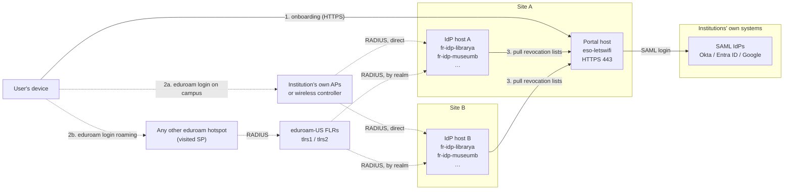
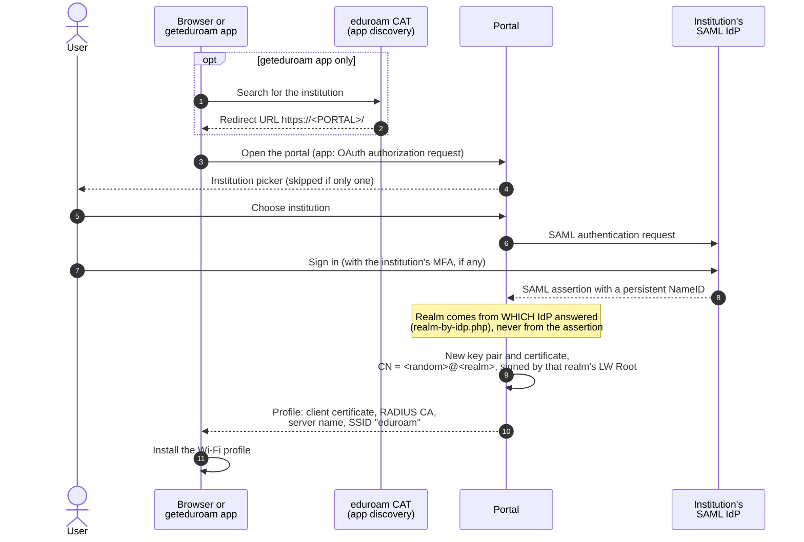
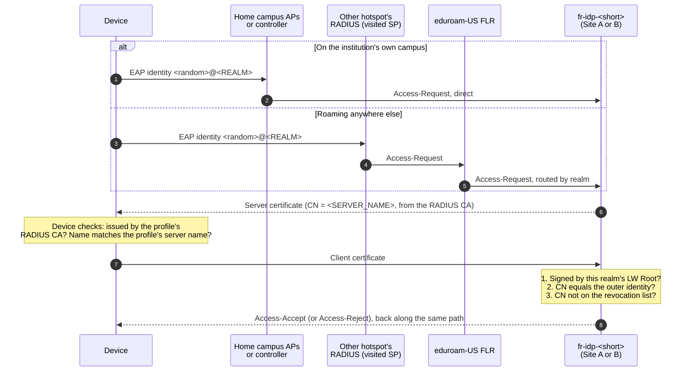
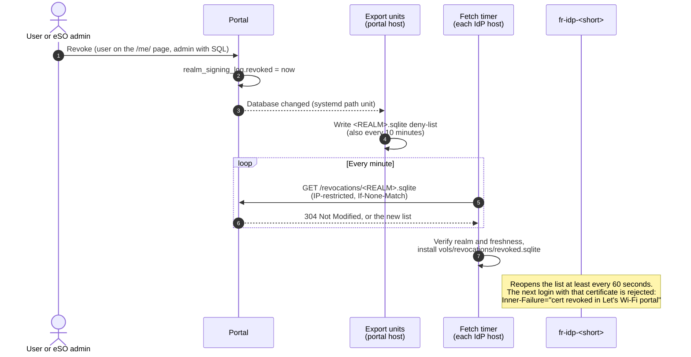

# Hosting eduroam with Let's Wi-Fi certificates: a production guide for eSOs

This guide adds a Let's Wi-Fi portal to an eduroam Support Organization (eSO)'s existing eduroam IdPs. Users sign in once with their institution's single sign-on, get a personal Wi-Fi certificate, and connect to eduroam without a password. It covers 1 to 10 institutions on 1 to 3 container hosts, optionally split across two locations.

**Start here:** each institution needs a working, registered eduroam IdP built with [public-eso-tools](https://github.com/nshe-scs/public-eso-tools), set up as its README describes. This guide doesn't repeat that setup. It deploys the portal, connects it to those IdPs, and switches each IdP to certificate logins.

**What you add:**

- **One Let's Wi-Fi portal** ([eso-letswifi](#software)) for every institution you host. It issues certificates after a SAML login.
- **The `letswifi` identity source** in each institution's public-eso-tools IdP containers, which checks those certificates at every login.
- **A CAT profile per institution** that sends users and the geteduroam apps to the portal.

**Conventions:** run commands as root on the host named in the step. `<ANGLE_BRACKETS>` are values from your [planning worksheet](#planning-worksheet). Examples use the eSO domain `roam.example.org`, the portal `lets.roam.example.org`, and an institution "Library A" with realm `librarya.org` and IdP server name `librarya.roam.example.org`.

## Table of contents

1. [How it fits together](#how-it-fits-together)
   - [Architecture](#architecture)
   - [Onboarding: getting a certificate](#onboarding-getting-a-certificate)
   - [Authentication: connecting to eduroam](#authentication-connecting-to-eduroam)
   - [Revocation: cutting off a certificate](#revocation-cutting-off-a-certificate)
2. [Planning](#planning)
   - [Prerequisites](#prerequisites)
   - [Deployment patterns](#deployment-patterns)
   - [Host sizing](#host-sizing)
   - [Certificate lifetime](#certificate-lifetime)
   - [Planning worksheet](#planning-worksheet)
   - [Network](#network)
3. [Part 1: Set up the portal host](#part-1-set-up-the-portal-host)
4. [Part 2: Onboard an institution](#part-2-onboard-an-institution)
   - [2.1 Collect the IdP's details](#21-collect-the-idps-details)
   - [2.2 Create the institution's LW Root and realm](#22-create-the-institutions-lw-root-and-realm)
   - [2.3 Connect the institution's SAML IdP](#23-connect-the-institutions-saml-idp) (Okta, Entra ID, Google Workspace)
   - [2.4 Switch the IdP to Let's Wi-Fi](#24-switch-the-idp-to-lets-wi-fi)
   - [2.5 Test before going public](#25-test-before-going-public)
   - [2.6 Publish in eduroam CAT](#26-publish-in-eduroam-cat)
5. [Acceptance tests](#acceptance-tests)
6. [Operations](#operations)
7. [Troubleshooting](#troubleshooting)
8. [Reference](#reference)
   - [Software](#software)
   - [Where things live](#where-things-live)
   - [Sources](#sources)

## How it fits together

### Architecture

The portal runs once, at one site. Each institution's IdP container runs on every IdP host, so either site can answer its logins. Logins arrive by two paths: on its own campus, an institution's access points send them straight to its IdP containers; anywhere else, the eduroam-US national proxies (FLRs) route them by realm.



| Component | Runs where | Holds | If it's down |
|---|---|---|---|
| Portal (`eso-letswifi`) | One host, Site A | Every institution's signing CA (LW Root), the certificate database, SAML config | No new certificates or self-service revocations. Existing certificates keep working. |
| IdP container (public-eso-tools) | Every IdP host, one per institution | Its RADIUS CA, its realm's LW Root *certificate*, its revocation list | Logins fail over to the copy at the other site, if the FLRs and the institution's controller list both. |
| Revocation fetch timer | Every IdP host, one per container | Nothing | That host's lists stop updating; logins continue with the last list. |

Two private CAs per institution keep the trust relationships separate:

| CA | Created | Signs | Who trusts it |
|---|---|---|---|
| **RADIUS CA** | When the IdP was set up (public-eso-tools `bootstrap-ca.sh`) | The IdP container's server certificate (CN = its `FR_IDP_FQDN`) | Users' devices, via their profiles. Also goes into CAT. |
| **LW Root** | In 2.2 (eso-letswifi `bootstrap-ca.sh`) | Users' client certificates | Only the IdP container. **Never** put it in CAT or a Wi-Fi profile. |

### Onboarding: getting a certificate

A user gets a certificate either from the portal's web page or from the geteduroam app, which finds the portal through eduroam CAT. Both end with the same certificate and profile.



### Authentication: connecting to eduroam

A login reaches the institution's IdP container by one of two paths. On the institution's own campus, its access points or wireless controller send it straight to the container. Anywhere else, the visited hotspot sends it to the FLRs, which route it by realm. Either way, the container accepts only certificates from its realm's LW Root that aren't on its revocation list.



Every request, challenge and fragment travels the whole path (through the FLR when roaming), so one login is typically 4 to 6 round trips. The IdP logs one line per login, with `Req-Count` (requests received) and `Elapsed-Ms`.

### Revocation: cutting off a certificate

A revocation in the portal reaches every IdP host within about two minutes.



Revocation stops new logins, not sessions that are already connected. Those end at the access point's next re-authentication.

## Planning

### Prerequisites

- [ ] **For each institution, a public-eso-tools IdP** running on each IdP host and registered in the eduroam-US Federation Manager, per [its README](https://github.com/nshe-scs/public-eso-tools). Note its realm (`FR_IDP_REALM`) and server name (`FR_IDP_FQDN`).
- [ ] **eduroam CAT** admin access for each institution ([cat.eduroam.org/admin](https://cat.eduroam.org/admin/)).
- [ ] **An ACME certificate account with External Account Binding (EAB)** for the portal's public certificate, such as InCommon's CERTInext: an ACME credential tied to a product that allows ECC-256 keys, with domain control validation done for your domain. Note the directory URL, Key ID and HMAC key.
- [ ] **A RHEL 9 host for the portal,** registered with Red Hat (the build installs `mod_md` from RHEL AppStream). It can be one of the IdP hosts.
- [ ] **DNS:** an A record for `<PORTAL>`.
- [ ] **For each institution:** an administrator of its Okta, Entra ID or Google Workspace who can create a SAML app, and someone to test.
- [ ] **A secrets vault** for each institution's LW Root key. It signs certificates for 20 years.
- [ ] **IdP log retention.** eduroam IdPs must log every authentication and keep the logs for the federation's minimum: six months for eduroam-US (the global eduroam Compliance Statement sets three, unless a federation or regulation requires more). With `FR_LOG_DESTINATION=file`, the container's log directory must be bind-mounted on the host, or the log disappears with the container; rotation and retention are up to you, per the public-eso-tools README.

### Deployment patterns

| Hosts | Site A | Site B | Survives losing |
|---|---|---|---|
| **1** | Portal + all IdP containers | — | Nothing. Fine for a pilot. |
| **2** | Portal + all IdP containers | All IdP containers | Either site for logins. Onboarding needs Site A. |
| **3** | Portal host; IdP host with all IdP containers | IdP host with all IdP containers | Either site for logins, and keeps the portal off the RADIUS hosts. |

Hosts can be VMs. Each institution's container runs with identical settings on every IdP host.

### Host sizing

Small hosts are enough, and the number of users barely matters: even 20 institutions × 2,000 users, each connecting several times a day, average well under 10 logins per second, at a few milliseconds of CPU each. The figures below are the operating system's baseline plus what the software measured in testing:

- **Each IdP container:** about 55 MB of memory. All of them share one small FreeRADIUS image, because identical builds reuse cached layers.
- **The portal:** under 100 MB of memory in testing; allow a few hundred MB for PHP-FPM workers in production. Its load comes from enrollments, not from the number of IdPs. Its image is about 1 GB, and the weekly rebuild prunes old ones.
- **The OS:** RHEL 9 needs at least 10 GiB of disk; 2 GB of RAM and 20 GB of disk are the usual practical minimum.

| Host | 1 IdP | 5 IdPs | 20 IdPs |
|---|---|---|---|
| IdP-only host | 1 vCPU, 2 GB RAM, 20 GB disk | 1 vCPU, 2 GB RAM, 20 GB disk | 1 vCPU, 3 GB RAM, 30 GB disk |
| Portal + IdPs on one host | 2 vCPU, 2 GB RAM, 25 GB disk | 2 vCPU, 3 GB RAM, 25 GB disk | 2 vCPU, 4 GB RAM, 35 GB disk |

A portal-only host needs 2 vCPU, 2 GB RAM and 25 GB of disk at any scale; its second vCPU only speeds up the weekly image rebuild.

**Disk for IdP logs.** IdP logs must be kept for your federation's retention period (see [Prerequisites](#prerequisites)). Each login writes about 300 bytes: an IdP with 2,000 users connecting five times a day writes about 3 MB a day, or about 550 MB per six months uncompressed. The table's larger disks cover 20 IdPs logging to files with compressed rotation; if your IdPs log to a remote syslog server instead, as the public-eso-tools README recommends, the 20 GB figures are enough.

### Certificate lifetime

Decide how long users' certificates should last before creating realms; it's each realm's `--days` in 2.2. Five years, two, or one are all reasonable.

Shorter lifetimes add little security, because revocation already cuts a certificate off within minutes. They do make users re-enroll more often, and every re-enrollment adds another certificate to the portal's records. Longer lifetimes keep revoked certificates on the revocation list longer, since the list holds only revoked certificates that haven't expired yet; even so, it stays small.

You can change a realm's lifetime later (its `validity` in `vols/letswifi-config/realms/<REALM>.conf.php`); it applies to new certificates only.

### Planning worksheet

One row per institution. Take the realm and server name from the institution's existing IdP (2.1).

| Short | Institution | Realm (`FR_IDP_REALM`) | Server name (`FR_IDP_FQDN`) | SAML IdP | IdP entityID |
|---|---|---|---|---|---|
| `librarya` | Library A | `librarya.org` | `librarya.roam.example.org` | Okta | from its metadata |
| `museumb` | Museum B | `museumb.org` | `museumb.roam.example.org` | Entra ID | from its metadata |
| `schoolc` | School C | `schoolc.roam.example.org` | `schoolc.roam.example.org` | Google | from its metadata |

Both values must match exactly wherever they appear, and a mismatch fails quietly:

- **The realm:** in the Federation Manager, the IdP's `FR_IDP_REALM`, and the portal's realm. Otherwise logins never arrive, or the IdP treats them as a visitor's and proxies them back to the FLRs.
- **The server name:** in the IdP's `FR_IDP_FQDN`, the portal realm's `--server-name`, and CAT. Otherwise devices refuse the IdP's certificate. It can equal the realm (School C) or not (Library A).

eSO-wide values:

| Value | Example |
|---|---|
| `<PORTAL>`, the portal's hostname | `lets.roam.example.org` |
| `<PORTAL_IP>`, its public IP | `192.0.2.10` |
| IdP hosts' outbound IPs, as the portal sees them | `192.0.2.20` (Site A), `198.51.100.20` (Site B) |
| Certificate lifetime in days | `1825` |

### Network

| From | To | Port | Purpose |
|---|---|---|---|
| Internet (users) | Portal | TCP 443 | Portal pages, SAML, the apps' OAuth. Port 80 is not used. |
| IdP hosts | Portal | TCP 443 | Revocation lists (`/revocations/`, IP-restricted) |
| Portal host | ACME server | TCP 443 | Public TLS certificate |
| Portal host | `registry.access.redhat.com`, `github.com`, `raw.githubusercontent.com`, RHEL repos | TCP 443 | Builds and updates |

RADIUS traffic is unchanged from the IdPs' existing setup. EAP-TLS packets can exceed 1,500 bytes, though, so every firewall between the FLRs or campus controllers and the IdP hosts must pass fragmented UDP.

## Part 1: Set up the portal host

Do this once. The portal lives in `/app/library/eso-letswifi`; its revocation units expect that path, so keep it or edit `revocations/systemd/*` to match.

**1. Install the tools and the code.**

```sh
subscription-manager status                      # must not say Unknown; the build needs RHEL AppStream
dnf install -y podman git openssl sqlite python3
dnf install -y epel-release && dnf install -y podman-compose
git clone https://github.com/nshe-scs/public-eso-letswifi.git /app/library/eso-letswifi
cd /app/library/eso-letswifi
```

**2. Create `custom.env`** and fill it in following the comments in the file: the portal's hostname and public IP, its name and support contact, the ACME credentials, and `LETSWIFI_REVOCATION_CLIENTS` (the IdP hosts' outbound IPs, separated by spaces; `127.0.0.1` until you know them).

```sh
cp custom.env.example custom.env && chmod 600 custom.env
ls -l .env                                       # must be a symlink to custom.env
vi custom.env
```

**3. Create the storage directories.** The container runs as UID 1001.

```sh
mkdir -p vols/{letswifi-config,letswifi-var,ssp-config,md,revocations}
chown -R 1001:0 vols && chmod -R 750 vols
```

**4. Build and start.**

```sh
podman-compose up -d --build
podman logs -f eso-letswifi
```

On first start, the container creates its database, secrets and SAML key pair, then orders the portal's certificate from your ACME server. Wait for:

```
The Managed Domain <PORTAL> has been setup and changes will be activated on next (graceful) server restart.
```

Then activate the certificate, and check from another machine:

```sh
podman kill --signal USR1 eso-letswifi

echo | openssl s_client -connect <PORTAL>:443 -servername <PORTAL> 2>/dev/null \
  | openssl x509 -noout -issuer -enddate -text | grep -E 'Issuer:|Not After|NIST CURVE'
curl -s https://<PORTAL>/simplesaml/module.php/saml/sp/metadata/default-sp | grep -o 'entityID="[^"]*"'
```

Expected: your ACME CA as issuer, `NIST CURVE: P-256`, and the SP entityID. Until the certificate is activated, HTTPS answers 503; that's expected. The home page shows `realm map cannot be empty` until the first institution is onboarded.

**5. Restart at boot and rebuild weekly.** The rebuild picks up Red Hat's patches and activates any renewed certificate.

```sh
systemctl enable --now podman-restart.service

cat > /etc/systemd/system/letswifi-rebuild.service <<'UNIT'
[Service]
Type=oneshot
# A full rebuild takes several minutes; the systemd default would stop it after 90 seconds
TimeoutStartSec=1h
ExecStart=/app/library/eso-letswifi/rebuild.sh
UNIT

cat > /etc/systemd/system/letswifi-rebuild.timer <<'UNIT'
[Timer]
OnCalendar=Sun 04:30
Persistent=true
[Install]
WantedBy=timers.target
UNIT

systemctl daemon-reload && systemctl enable --now letswifi-rebuild.timer
```

**6. Publish revocation lists.** Set `LETSWIFI_REVOCATION_CLIENTS` to the IdP hosts' outbound IPs and recreate the container, then start the exporter. It republishes on every database change and every 10 minutes.

```sh
podman-compose down && podman-compose up -d
cp revocations/systemd/letswifi-revocations-export.* /etc/systemd/system/
systemctl daemon-reload
systemctl enable --now letswifi-revocations-export.path letswifi-revocations-export.timer
```

From each IdP host, check that the portal lets it fetch lists:

```sh
curl -s -o /dev/null -w '%{http_code}\n' https://<PORTAL>/revocations/no-such-realm.sqlite
```

`404` means allowed (the file just doesn't exist); `403` means the portal doesn't recognize that host's address. If an IdP host *is* the portal host, its requests may reach the container from an internal address: find it in `podman logs eso-letswifi` and add it to `LETSWIFI_REVOCATION_CLIENTS`.

**7. Back up `vols/` nightly, encrypted.** It holds every institution's LW Root private key, the SAML key pair and the certificate database.

## Part 2: Onboard an institution

Repeat this part for each institution, in order: the portal needs the IdP's details before it can create the realm, the realm must exist before a SAML IdP can be mapped to it, and CAT comes last because it makes the institution visible in the geteduroam apps. The examples use Library A: short name `librarya`, realm `librarya.org`, server name `librarya.roam.example.org`.

### 2.1 Collect the IdP's details

On any IdP host, in the institution's public-eso-tools container directory:

```sh
grep -E '^FR_(IDP_REALM|IDP_FQDN)=' custom.env
grep '^FR_TLS_CA_CERT_BASE64=' custom.env | cut -d= -f2- | base64 -d > radius-ca-librarya.pem
openssl x509 -in radius-ca-librarya.pem -noout -subject
```

Record the realm and server name in the worksheet, and copy `radius-ca-librarya.pem` to `/root/ca/librarya/` on the portal host. It's the RADIUS CA's certificate only; its key stays with the IdP.

### 2.2 Create the institution's LW Root and realm

On the portal host. Set the first line for the institution; the rest is the same every time.

```sh
SHORT=librarya REALM=librarya.org SERVER_NAME=librarya.roam.example.org NAME="Library A" DAYS=1825

alias lw='podman exec -i eso-letswifi php /opt/app-root/letswifi/bin/letswifi'
subject() { openssl x509 -in "$1" -noout -subject -nameopt RFC2253 | sed 's/^subject=//'; }
mkdir -p /root/ca/$SHORT && chmod 700 /root/ca/$SHORT && cd /root/ca/$SHORT

bash /app/library/eso-letswifi/bootstrap-ca.sh                  # creates letswifi_ca_<serial>.pem and .key
cat letswifi_ca_*.pem letswifi_ca_*.key | lw ca import          # the LW Root, with its key
lw ca import < radius-ca-$SHORT.pem                             # the RADIUS CA, certificate only

lw realm create "$REALM" \
  --signer "$(subject letswifi_ca_*.pem)" \
  --trust "$(subject radius-ca-$SHORT.pem)" \
  --server-name "$SERVER_NAME" --network eduroam --days "$DAYS" --name "$NAME"
lw realm view "$REALM"

/app/library/eso-letswifi/realm-ca-cert.py "$REALM" > lwca-$SHORT.b64
systemctl start letswifi-revocations-export.service
```

- **Check `lw realm view`:** `signer` and `trust` must show the two CA names, and `server_name` the IdP's `FR_IDP_FQDN`. letswifi doesn't validate them at creation.
- **`--days`** is the certificate lifetime you chose in [planning](#certificate-lifetime).
- **`lwca-<short>.b64`** holds the LW Root's certificate (never its key), for the IdP in 2.4. `realm-ca-cert.py` explains itself on stderr.
- **Vault `letswifi_ca_*.key` now,** then shred this copy; the portal keeps its own in `vols/`.

### 2.3 Connect the institution's SAML IdP

Send the institution's administrator:

- **SP entity ID:** `https://<PORTAL>/simplesaml/module.php/saml/sp/metadata/default-sp`
- **ACS (reply) URL:** `https://<PORTAL>/simplesaml/module.php/saml/sp/saml2-acs.php/default-sp`
- **NameID format: persistent,** with a value that never changes for a person. The NameID is the user's permanent identity in the portal, used to list and revoke their certificates. No other attributes are needed.

| IdP | Where | Persistent NameID value |
|---|---|---|
| **Okta** | Applications → Create App Integration → SAML 2.0. Single sign-on URL = ACS URL; Audience URI = SP entity ID. Then assign users, and save the XML from **Sign On → Metadata URL**. | Name ID format **Persistent**; Application username **Custom**: `user.getInternalProperty("id")` (the immutable Okta user ID) |
| **Microsoft Entra ID** | Enterprise apps → New application → Create your own application (non-gallery). SAML: Identifier = SP entity ID; Reply URL = ACS URL. Then assign users, and download **Federation Metadata XML.** | Attributes & Claims → Unique User Identifier: format **Persistent**, source `user.objectid` |
| **Google Workspace** | Apps → Web and mobile apps → Add app → Add custom SAML app; download the IdP metadata. ACS URL and Entity ID as above. Then turn **User access** on for the right organizational units. | Name ID format **PERSISTENT**. Google has no immutable user ID here: use an attribute that never changes if you maintain one; Primary email works but changes when a user is renamed. |

**Install the metadata and map the IdP to its realm,** on the portal host:

```sh
cd /app/library/eso-letswifi
install -o 1001 -g 0 -m 640 <received file>.xml vols/ssp-config/metadata/librarya.xml
grep -o 'entityID="[^"]*"' vols/ssp-config/metadata/librarya.xml
grep -c 'OrganizationDisplayName\|mdui:DisplayName' vols/ssp-config/metadata/librarya.xml
```

If the second `grep` prints `0`, as it usually does for all three vendors, the institution picker would show the raw entityID. Add a display name; this works with or without an `md:` prefix in the file, and editing a signed file is fine because the portal doesn't verify signatures on local metadata:

```sh
f=vols/ssp-config/metadata/librarya.xml; NAME="Library A"; URL="https://librarya.example.org/"
sed -i "s#</\([A-Za-z0-9]*:\)\{0,1\}EntityDescriptor>#<Organization xmlns=\"urn:oasis:names:tc:SAML:2.0:metadata\"><OrganizationName xml:lang=\"en\">$NAME</OrganizationName><OrganizationDisplayName xml:lang=\"en\">$NAME</OrganizationDisplayName><OrganizationURL xml:lang=\"en\">$URL</OrganizationURL></Organization>&#" "$f"
```

Then add one line inside the `return [ … ];` block of `vols/ssp-config/realm-by-idp.php`, with the entityID exactly as `grep` printed it, and check the file:

```php
    'http://www.okta.com/exk1a2b3c4d5e6f7g8h9' => 'librarya.org',
```

```sh
podman exec eso-letswifi php -l /opt/app-root/letswifi/simplesamlphp/config/realm-by-idp.php
```

Both changes take effect within seconds. The institution appears in the picker once it has a metadata file and a mapping; with only one institution, the picker is skipped.

### 2.4 Switch the IdP to Let's Wi-Fi

On **each** IdP host, in the institution's container directory, follow the Let's Wi-Fi section of the [public-eso-tools README](https://github.com/nshe-scs/public-eso-tools). In summary:

- **In `custom.env`:** `FR_IDENTITY_SOURCE=letswifi`, `FR_LETSWIFI_CA_CERT_BASE64=` the contents of `lwca-librarya.b64`, and `FR_LETSWIFI_REVOCATIONS_URL=https://<PORTAL>/revocations`.
- **Revocation lists:** enable the container's fetch timer and the `/revocations` mount, as the README describes.
- **Recreate the container,** and check its startup log:

```
Will accept client certs signed by 1 Let's Wi-Fi root CA cert(s).
Container host will pull revocation lists from 'https://<PORTAL>/revocations'.
Revocation list for 'librarya.org': 0 revoked cert(s), generated <time> UTC.
```

**Check the logs persist.** If the container logs to a file, its `/var/log/freeradius` must be bind-mounted to the host (the `./vols/log/` line in its `docker-compose.yml`); Let's Wi-Fi logins are logged like any other, with the certificate's random ID as `Inner-User`.

**Plan the cutover with the institution.** Switching ends password (TTLS) logins for that realm: users need a certificate from the portal from then on.

### 2.5 Test before going public

Make a test certificate. Sign in to `https://<PORTAL>/` as a test user of the institution, open the list of all apps and profiles, and download the **eap-config** file. Extract the certificate and key for the test tools:

```sh
f=<downloaded>.eap-config
grep -o '<Passphrase>[^<]*' "$f"                       # the PKCS#12 passphrase
sed -n 's:.*<ClientCertificate format="PKCS12" encoding="base64">\([^<]*\)</ClientCertificate>.*:\1:p' "$f" | base64 -d > test.p12
openssl pkcs12 -in test.p12 -passin pass:<passphrase> -nokeys -clcerts -out test-cert.pem
openssl pkcs12 -in test.p12 -passin pass:<passphrase> -nocerts -nodes -out test-key.pem
```

(Add `-legacy` if OpenSSL refuses the file.) Run the Federation Manager's EAP-TLS test with it, then the rest of the [acceptance tests](#acceptance-tests) for this institution. Revoke the test certificate afterwards.

### 2.6 Publish in eduroam CAT

Do this last: within about 1.5 hours, the institution appears in the geteduroam apps for everyone. In [CAT admin](https://cat.eduroam.org/admin/), for the institution's profile:

1. **Realm:** `librarya.org`.
2. **EAP type:** TLS only.
3. **Server name:** `librarya.roam.example.org`, the IdP's `FR_IDP_FQDN`.
4. **CA certificate:** `radius-ca-librarya.pem`, the **RADIUS CA**. **Never** the LW Root (`letswifi_ca_*.pem`): it signs user certificates, and trusting it for the server would let anyone holding a user certificate impersonate the RADIUS server to clients that don't enforce certificate purposes.
5. **Redirect:** `https://<PORTAL>/#letswifi`. This sends website visitors to the portal, and tells the geteduroam apps to use the portal's certificate flow.
6. Run CAT's **live login test** with the test certificate from 2.5. Expect an accept, and in the IdP's log two concurrent logins via the international proxies (`Operator-Name = "1cat.eduroam.org"`).

CAT's change reaches the app directory in about 15 minutes, and the apps may cache it for an hour. Then test the in-app flow (acceptance test 12).

## Acceptance tests

Run tests 1–6 once after Part 1, and tests 7–16 for each institution. Use a private browser window for each login.

| # | Test | How | Expected |
|---|---|---|---|
| 1 | Portal certificate | The `openssl s_client` check in Part 1 step 4 | Your ACME CA as issuer, P-256, expiry months away |
| 2 | SP metadata | `curl -s https://<PORTAL>/simplesaml/module.php/saml/sp/metadata/default-sp` | XML with signing and encryption keys and a `persistent` NameIDFormat |
| 3 | List access, from each IdP host | The `curl` check in Part 1 step 6 | `404`, not `403` |
| 4 | Exporter | `journalctl -u letswifi-revocations-export -n 5` | One `published <realm>: …` line per realm |
| 5 | Weekly rebuild | `systemctl start letswifi-rebuild.service`, then test 7 again | Container healthy; earlier certificates still in the database |
| 6 | Reboot | Reboot the portal host, then `podman ps` | `eso-letswifi` back up on its own |
| 7 | Institution login | Open `https://<PORTAL>/`, choose the institution, sign in as an assigned user | Listed by name; the download page offers that institution's realm only |
| 8 | Certificate contents | Download the certificate (PKCS#12), then the `openssl` command below | CN `<random>@<REALM>`, issuer that realm's LW Root, P-256, the lifetime you chose |
| 9 | Audit record | The `sqlite3` query below | One row per download; `requester` is `<NameID>@<REALM>` |
| 10 | IdP, on each IdP host | The container's startup log (2.4), and `journalctl -u 'letswifi-revocations-fetch@*' -n 5` | The three startup lines; `installed export …`, then `not modified` each minute |
| 11 | Federation Manager EAP-TLS test | With the test certificate from 2.5 | All attempts accepted; IdP log `Send-Access-Accept … Req-Count=4` to `6` |
| 12 | geteduroam app | After 2.6 and up to 1.5 hours: find the institution in the app, sign in, let it configure Wi-Fi | App installs the network and connects |
| 13 | Real devices, roaming | On another institution's eduroam, with a profile from the portal: Android, iOS, macOS, Windows | Connects; the IdP log shows an FLR as `Client-IP-Address` |
| 14 | Real devices, on campus | On the institution's own eduroam | Connects; the IdP log shows the institution's controller as `Client-IP-Address` |
| 15 | Live revocation | Revoke test 13's certificate at `https://<PORTAL>/me/`, wait 2 minutes, reconnect | Refused; IdP log `Inner-Failure="cert revoked in Let's Wi-Fi portal"` |
| 16 | Site failover (2–3 hosts) | Stop the institution's container on one IdP host; rerun tests 11 and 14; start it again | Both still accepted, via the other host |

Commands for tests 8 and 9:

```sh
openssl pkcs12 -in <downloaded>.p12 -nokeys -clcerts | openssl x509 -noout -subject -issuer -enddate -text | grep -E 'subject=|issuer=|notAfter|NIST CURVE'
sqlite3 /app/library/eso-letswifi/vols/letswifi-var/letswifi.sqlite \
  "select serial, realm, requester, client, expires, revoked from realm_signing_log order by serial desc limit 10"
```

**Before testing on Android:** remove ("forget") any eduroam network the device already has, whether from CAT or set up by hand. Android may otherwise keep using the old network's settings, such as a different server name, and fail with no useful error on the device.

## Operations

**Reading failed logins.** For Let's Wi-Fi logins, the IdP's reject log line says why in one of two fields:

| Logged | Meaning |
|---|---|
| `Inner-Failure="cert revoked in Let's Wi-Fi portal"` | The certificate was revoked. |
| `Inner-Failure="cert CN doesn't match outer identity"` | The device's outer identity was changed by hand. Reinstall the profile unchanged. |
| `Module-Failure="… OpenSSL says error 10 : certificate has expired"` | The user needs a new certificate from the portal. |
| `Module-Failure="… OpenSSL says error 19 : self-signed certificate in certificate chain"` (or another "OpenSSL says error" about the issuer) | The certificate wasn't issued by this realm's LW Root: a profile from another realm, or an LW Root missing from `FR_LETSWIFI_CA_CERT_BASE64`. |
| `Module-Failure="… Alert read:fatal:unknown CA"` | The **device** rejected the IdP: its profile trusts a different RADIUS CA from the IdP's. |
| `Module-Failure="… Alert read:fatal:internal error"` (or another `Alert read:`) | The **device** rejected the IdP, usually over the server name: a stale saved network, or the realm's `--server-name` ≠ the IdP's `FR_IDP_FQDN`. |

`Alert read:` means the device ended the login; anything else in `Module-Failure` is the IdP rejecting the device.

**Revoking a certificate for someone.** Users revoke their own at `https://<PORTAL>/me/`. An eSO admin revokes on the portal host, by person or by certificate:

```sh
cd /app/library/eso-letswifi
# find them: requester is <NameID>@<REALM>
sqlite3 vols/letswifi-var/letswifi.sqlite \
  "select serial, requester, ident, issued, revoked from realm_signing_log where realm = '<REALM>' and requester like '%<part of NameID>%'"
# revoke all of one person's certificates (or use: where serial = <n> and revoked is null)
sqlite3 vols/letswifi-var/letswifi.sqlite \
  "update realm_signing_log set revoked = strftime('%Y-%m-%d %H:%M:%S', 'now') where requester = '<NameID>@<REALM>' and revoked is null; select changes();"
```

The exporter notices the change at once; every IdP host has it within about two minutes. Revocation can't be undone; the person simply enrolls again.

**Offboarding an institution.**

1. **Portal:** remove its line from `realm-by-idp.php` and its metadata file. New enrollments stop within seconds.
2. **Revoke its certificates:** `update realm_signing_log set revoked = strftime('%Y-%m-%d %H:%M:%S', 'now') where realm = '<REALM>' and revoked is null`.
3. **IdP hosts:** reconfigure or remove its containers per the public-eso-tools README, and disable their revocation fetch timers.
4. **Update or remove** its registrations in CAT and the Federation Manager accordingly.

**Replacing an institution's LW Root.** This is rare: a planned rollover well before the root's 20-year expiry, or right away if its private key may have been exposed. Create and import a new root (2.2's `bootstrap-ca.sh` and `ca import` lines), then change the `signer` line in `vols/letswifi-config/realms/<REALM>.conf.php` to its name, so new certificates come from it. Rerun `realm-ca-cert.py <REALM>`, paste the result into `FR_LETSWIFI_CA_CERT_BASE64` on every IdP host, and recreate those containers.

- **Planned rollover:** until certificates from the old root expire or are revoked, `realm-ca-cert.py` prints both roots and says so, so existing users keep working. Rerun it later to drop the old root.
- **Exposed key:** don't keep the old root trusted. Put only the new root in `FR_LETSWIFI_CA_CERT_BASE64`; everyone must enroll again.

**Adding an IdP host later.** Set up the institutions' containers on it per the public-eso-tools README, with the same Let's Wi-Fi settings as 2.4. Add its outbound IP to `LETSWIFI_REVOCATION_CLIENTS` (and recreate the portal container), and update the Federation Manager and institutions' controllers as you would for any new IdP host.

**IdP logs.** Keep them for your federation's retention period (six months for eduroam-US). Each login's line records what eduroam requires of an IdP: the time, the outer identity (`User-Name`), the inner identity (`Inner-User`, the certificate's random ID), the device's MAC address (`Calling-Station-Id`) and the result (`action`). To trace an `Inner-User` back to a person, look up the certificate in the portal's database: `select requester, issued, revoked from realm_signing_log where ident like '<Inner-User>@%'`. For file logs, rotate them on the host and keep at least that long; the public-eso-tools README has a logrotate example.

**Backups.** The portal's `vols/`, nightly and encrypted: LW Root keys, the SAML key pair and the certificate database. Keep every LW Root key in your vault as well. The certificate database is also what ties an IdP log's `Inner-User` to a person, so keep its backups at least as long as the IdP logs.

## Troubleshooting

For failed logins, start with the IdP's log line (see [Operations](#operations)); for portal problems, with `podman logs eso-letswifi`.

| Symptom | Likely cause | Fix |
|---|---|---|
| The Federation Manager's tests reach the IdP, but every request is proxied straight back to the FLRs and rejected | The registered realm ≠ the IdP's `FR_IDP_REALM` | Make the realm identical everywhere ([worksheet](#planning-worksheet)) |
| Android installs the profile but never connects, with no useful error | An older saved eduroam network takes precedence over the new one | Forget every eduroam network on the device, then reinstall from the portal or app |
| Logins from some places stall during the certificate exchange | IP fragments dropped between the FLRs and the IdP host | Allow fragmented UDP on every firewall in the path |
| IdP container exits at start with an `FR_LETSWIFI_…` error | Missing value, a URL that isn't `https://`, or a private key pasted in | Fix `custom.env`; the CA value is exactly what `realm-ca-cert.py` printed |
| IdP warns at start that no revocation list is mounted | The fetch is failing | `journalctl -u 'letswifi-revocations-fetch@*'`: 403 → add the host to `LETSWIFI_REVOCATION_CLIENTS`; 404 → run the export (2.2) |
| Fetch gets 403 on the portal host itself | Its requests reach the container from an internal address | Add that address, from `podman logs eso-letswifi`, to `LETSWIFI_REVOCATION_CLIENTS` |
| Portal sign-in error: `must send a persistent NameID` | The SAML app sends a transient or missing NameID | Set the NameID format to persistent (2.3) |
| Portal sign-in error: `is not mapped to a realm` | The entityID in `realm-by-idp.php` doesn't match the metadata file | Copy it exactly from the `grep` in 2.3 |
| Picker shows a URL instead of a name | The metadata has no display name | Add one (2.3) |
| Portal home page: `realm map cannot be empty` | No institution mapped yet | Finish 2.3 |
| HTTPS answers 503; health check unhealthy | A new or renewed public certificate isn't active yet | `podman kill --signal USR1 eso-letswifi` |
| `realm create` worked, but profiles fail | A typo in `--signer`, `--trust` or `--server-name`; letswifi doesn't validate them | `lw realm view`; fix `vols/letswifi-config/realms/<REALM>.conf.php` |

**Harmless messages:** `EAP Total received record fragments … does not equal expected data length (0 bytes)` means the client sent a TLS message without the optional length field. `rlm_sql (sql_letswifi): … You may need to increase "spare"` is the revocation-list connection being reopened on schedule.

## Reference

### Software

| Component | Source | Contents |
|---|---|---|
| Portal | [public-eso-letswifi](https://github.com/nshe-scs/public-eso-letswifi) | [letswifi-portal](https://github.com/geteduroam/letswifi-portal) v2.0.0-beta7, SimpleSAMLphp 2.4.10, on Red Hat's `ubi9/php-83` |
| IdPs | [public-eso-tools](https://github.com/nshe-scs/public-eso-tools) | FreeRADIUS 3.2, with the `letswifi` identity source |
| Apps | [geteduroam](https://www.eduroam.app/) | Windows, macOS, iOS, Android, Linux |

### Where things live

On the portal host, under `/app/library/eso-letswifi`:

| Path | Contents |
|---|---|
| `custom.env` | All portal settings |
| `vols/letswifi-config/certs/` | LW Roots **with keys**, RADIUS CA certificates |
| `vols/letswifi-config/realms/` | One file per realm: signer, trust, server name, certificate lifetime |
| `vols/letswifi-var/letswifi.sqlite` | Every issued certificate: requester, dates, revocation |
| `vols/ssp-config/realm-by-idp.php`, `vols/ssp-config/metadata/` | IdP-to-realm map, IdP metadata |
| `vols/revocations/` | Published revocation lists |

On each IdP host, each institution's container keeps its downloaded list in `vols/revocations/` of its container directory.

### Sources

- [Pseudo-credential and CAT](https://www.eduroam.app/idp/cat/): creating the CAT profile with the `#letswifi` redirect, geteduroam documentation
- [geteduroam FAQ](https://www.eduroam.app/about/faq/): how the apps use CAT profiles for certificate portals
- [Create an app integration (SAML 2.0)](https://developer.okta.com/docs/guides/create-an-app-integration/saml2/main/) and [Okta Expression Language](https://developer.okta.com/docs/reference/okta-expression-language/) (`user.getInternalProperty("id")`), Okta Developer
- [Customize SAML token claims](https://learn.microsoft.com/en-us/entra/identity-platform/saml-claims-customization), Microsoft Learn
- [Set up your own custom SAML app](https://support.google.com/a/answer/6087519), Google Workspace Admin Help
